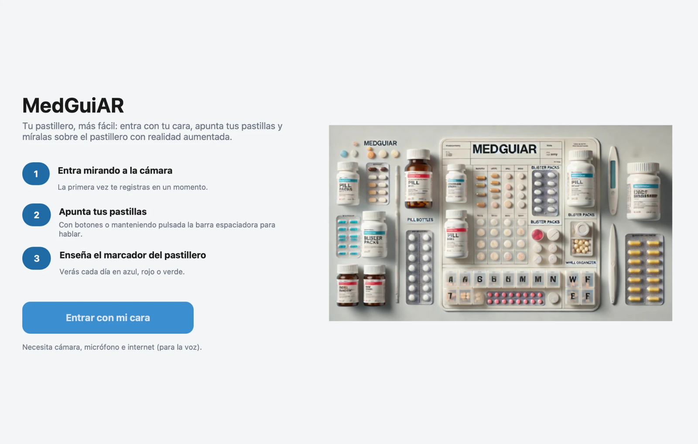
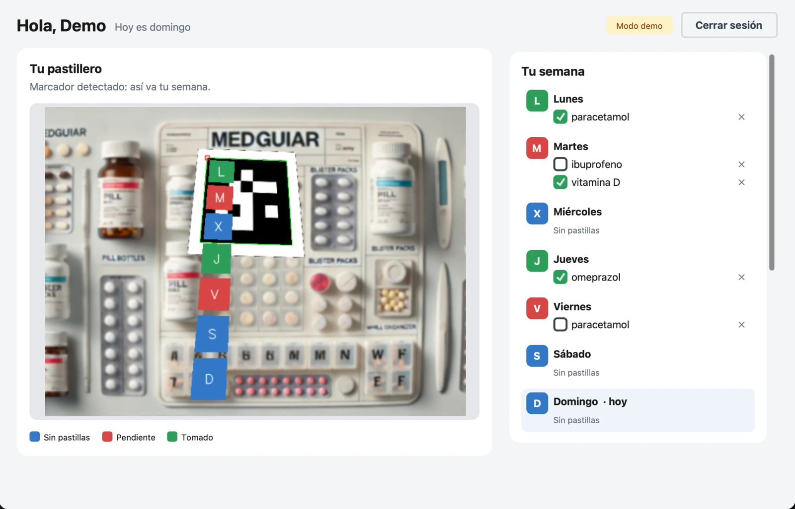
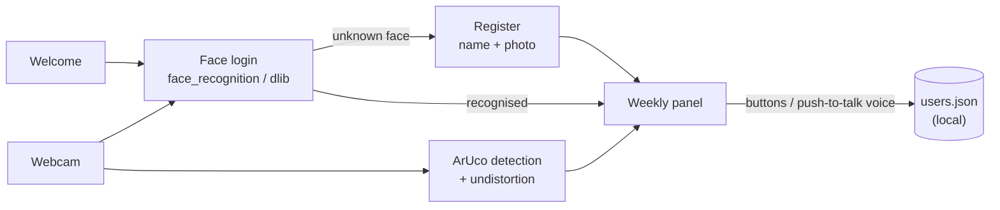

# MedGuiAR

A desktop medication assistant for older adults. You log in by looking at the camera, manage your weekly pills with buttons or Spanish voice commands, and see the week's status drawn on top of your pillbox with augmented reality.


## Screenshots

<!--
TODO: add the three screenshots to docs/screenshots/ and uncomment this block.

| Welcome | Face login | Weekly panel with AR |
| --- | --- | --- |
|  |  |  |
-->



## Features

- **Face login.** The camera recognises registered users (face_recognition/dlib) and logs them in automatically. A new user registers by typing a name, and the current frame is saved as their reference photo.
- **Weekly medication schedule.** Add pills per weekday, tick them as taken or remove them. The schedule is stored locally in `users.json`.
- **Push-to-talk voice commands (Spanish).** Hold the space bar or the on-screen button and say *«añadir lunes paracetamol»*, *«tomado lunes paracetamol»*, *«quitar lunes paracetamol»*, *«consulta»* or *«salir»*. Audio is transcribed with the Google Web Speech API, which needs an internet connection.
- **Augmented-reality calendar.** When an ArUco marker (`DICT_5X5_50`) placed on the pillbox is in view, seven boxes are drawn along it, warped to the marker's perspective. Each box is blue (nothing scheduled), red (pending) or green (all taken). Frames are undistorted with a ChArUco camera calibration.
- **Single, responsive window.** The camera, week view, add form and voice panel live in one window that adapts to its size, and all feedback is shown on screen.

## Tech stack

| Technology | Used for |
| --- | --- |
| Python 3.12 | Application language |
| OpenCV (`opencv-contrib-python` 4.x) | Camera capture, ArUco marker detection, undistortion and drawing the AR overlay |
| face_recognition + dlib | Face detection and 128-d face encodings for login |
| SpeechRecognition + PyAudio | Microphone capture and transcription through the Google Web Speech API (`es-ES`) |
| CustomTkinter (Tk) | Desktop user interface |
| Pillow, NumPy | Image conversion for the UI and array maths for the overlay |
| pytest | Unit tests for the schedule logic, voice-command parsing and the AR overlay |
| uv, Make | Python environment and one-command setup/run |

## Getting started

**Requirements**

- macOS with [Homebrew](https://brew.sh). Tested on Apple Silicon; other platforms are untested.
- A webcam, a microphone and an internet connection (for voice).
- To try the AR view, print [`docs/aruco-marker-5x5-id0.png`](docs/aruco-marker-5x5-id0.png) or open it on your phone.

**Run it**

```bash
git clone https://github.com/josedimas23/medguiar-ar-assistant.git
cd medguiar-ar-assistant
make setup   # brew install uv cmake portaudio flac + .venv with Python 3.12 + requirements
make run
```

The first time, macOS asks for camera and microphone access for your terminal app. Grant both (System Settings › Privacy & Security). `make setup` compiles dlib, which takes a few minutes.

<details>
<summary>Manual steps (what <code>make setup</code> and <code>make run</code> do)</summary>

```bash
brew install uv cmake portaudio flac
uv venv --python 3.12 --managed-python .venv
uv pip install --python .venv -r requirements.txt
.venv/bin/python MedGuiAR.py
```

- `uv`'s managed Python is used because Homebrew's Python ships Tk 9.1, which breaks `tkinter.simpledialog` on macOS.
- `flac` from Homebrew replaces the Intel-only FLAC binary bundled with SpeechRecognition, which fails on Apple Silicon.
</details>

**Other commands**

```bash
make test        # unit tests, no camera or microphone needed
make calibrate   # recalibrate your camera with a ChArUco board and regenerate camara.py
```

`camara.py` holds the calibration of the camera originally used for the project. For a more accurate AR overlay on a different webcam, run `make calibrate` with a 6×8 ChArUco board (`DICT_6X6_250`).

**Privacy.** Users, schedules and face photos are stored only on your machine (`users.json`, `imagenes/`), and both are git-ignored. Voice audio is sent to Google's speech service for transcription.

## Project structure

```
.
├── MedGuiAR.py          # entry point
├── medguiar/
│   ├── app.py           # CustomTkinter UI: welcome, face login, weekly panel
│   ├── face_auth.py     # face recognition login
│   ├── voice.py         # push-to-talk recording, transcription, command parsing
│   ├── ar.py            # ArUco detection, undistortion and weekly overlay
│   ├── schedule.py      # weekly schedule logic (pure functions)
│   ├── camera.py        # threaded webcam reader
│   └── storage.py       # users.json and face photos
├── tests/               # pytest suite
├── calibrar.py          # ChArUco calibration script (course material)
├── camara.py            # generated camera matrix + distortion coefficients
├── docs/                # printable ArUco marker, screenshots
├── fondo.jpeg           # welcome-screen illustration
├── Makefile
└── requirements.txt
```

## What I learned

- **Combining three perception techniques in one product.** Face recognition handles identity, speech handles input and marker-based AR handles output. The work was in making them share one camera and one data model so they behave as a single app.
- **The geometry behind marker-based AR.** Calibrating a camera, undistorting frames and using a perspective transform so that 2D content follows a marker as it tilts and moves.
- **Keeping a desktop UI responsive.** Camera capture, face recognition and voice run in worker threads that post results back to the Tk thread, so the window never freezes.
- **Platform issues show up after the fact.** When I revisited the project in 2026 it no longer ran on macOS. I had to deal with removed OpenCV and Pillow APIs, a Tk 9 incompatibility, Tk and OpenCV fighting over the Cocoa event loop, trackpad events Tk 9 handles differently, and an Intel-only binary inside a pip package. Pinning versions and documenting the setup were part of the fix.

## Context & credits

MedGuiAR was my **individual final project** for the course *Computación Ubicua e Inteligencia Ambiental* (Ubiquitous Computing and Ambient Intelligence) at the **University of Granada**, in 2024. I designed and wrote the application: face login, voice control, the AR overlay and the interface.

In 2026 I revisited it for this portfolio with the help of an AI coding assistant. I made it run on current macOS and Python 3.12, split it into modules, replaced the original Tkinter + OpenCV windows with a single CustomTkinter interface and added tests. The original 2024 version is the repository's first commit.

**Third-party material**

- `calibrar.py`: ChArUco camera-calibration script provided by the course's teaching staff. It is included with credit for reproducibility and is **not** covered by this repository's license.
- `fondo.jpeg`: AI-generated illustration used on the welcome screen.
- Libraries: [OpenCV](https://opencv.org) (Apache 2.0), [face_recognition](https://github.com/ageitgey/face_recognition) by Adam Geitgey (MIT) and [dlib](http://dlib.net) (Boost), [SpeechRecognition](https://github.com/Uberi/speech_recognition) (BSD), [CustomTkinter](https://github.com/TomSchimansky/CustomTkinter) (MIT).

Licensed under the [MIT License](LICENSE), except for the third-party material listed above.
